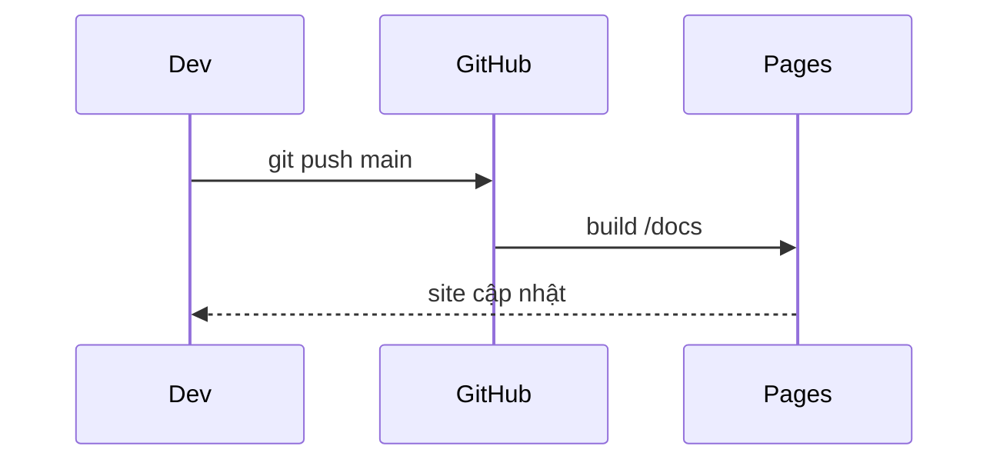

# Tính năng

Trang demo các thành phần Markdown mà Zensical hỗ trợ.

## Admonition

!!! note "Ghi chú"
    Khối ghi chú thông thường.

!!! success
    Thao tác thành công.

??? question "Khối có thể thu gọn (bấm để mở)"
    Nội dung ẩn, dùng `???` thay cho `!!!`.

## Tabs

=== "Python"

    ```python
    def greet(name: str) -> str:
        return f"Hello, {name}!"
    ```

=== "JavaScript"

    ```js
    export const greet = (name) => `Hello, ${name}!`;
    ```

## Code block có highlight dòng

```python linenums="1" hl_lines="2 3"
def build(src, out):
    pages = collect(src)
    render(pages, out)
    return len(pages)
```

## Mermaid



## Task list

- [x] Tạo repo public
- [x] Bật Pages từ `/docs`
- [x] Chuyển sang Zensical
- [ ] Thêm workflow cho branch `develop`

## Định dạng chữ

- ==Highlight==, ++ctrl+k++ (phím tắt), chú thích cuối trang[^1]
- Viết tắt: HTML, ADR

[^1]: Đây là footnote.

*[HTML]: HyperText Markup Language
*[ADR]: Architecture Decision Record
