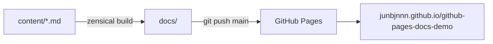

# Pages Docs Demo

Site này được viết bằng **Markdown**, build bằng [Zensical](https://zensical.org/) và publish qua
**GitHub Pages** từ folder `/docs` trên branch `main`.

-   :lucide-rocket: **Bắt đầu**

    ---

    Cài Zensical, build và publish site trong vài phút.

    [:octicons-arrow-right-24: Bắt đầu](getting-started.md)

-   :lucide-sparkles: **Tính năng**

    ---

    Admonition, tabs, code block, Mermaid, task list…

    [:octicons-arrow-right-24: Xem demo](features.md)

-   :lucide-chart-column: **Report**

    ---

    Bảng trạng thái mẫu, dùng CSS bổ sung.

    [:octicons-arrow-right-24: Xem report](report.md)

-   :lucide-scroll-text: **ADR**

    ---

    Các quyết định kiến trúc của project.

    [:octicons-arrow-right-24: Xem ADR](adr/index.md)

## Luồng publish

